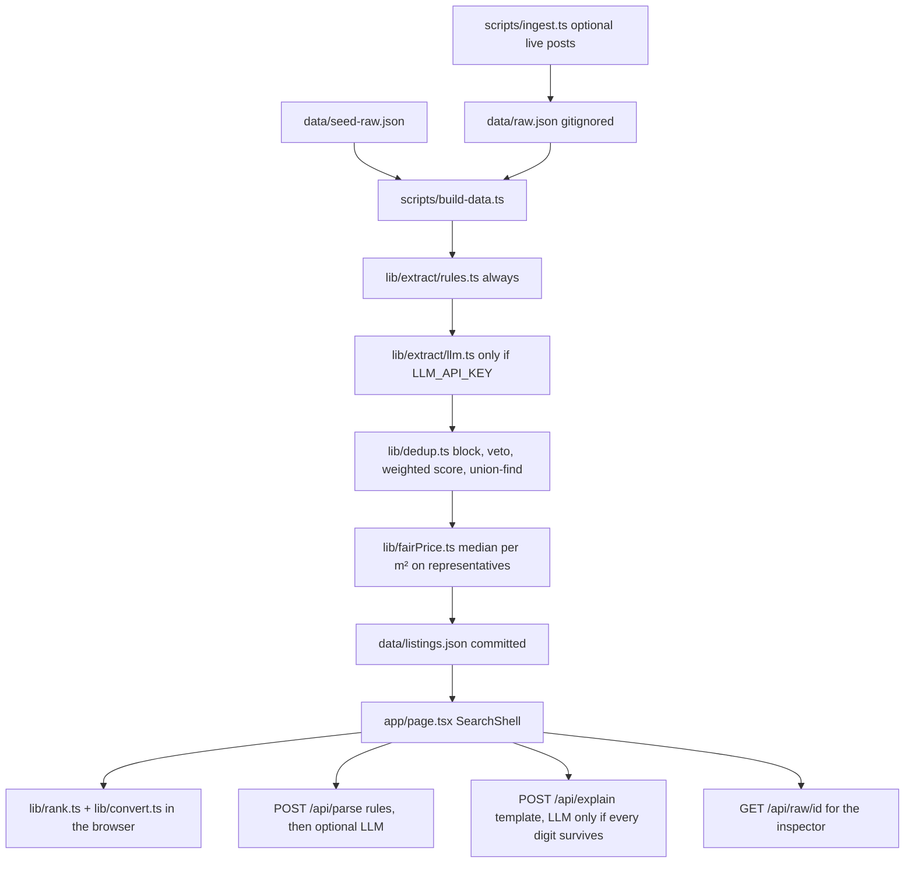

# ترب اجاره

📄 [نسخه فارسی مستندات پروژه](./README_FA.md)

🔗 Live Demo: https://torob-rent-project.vercel.app/

ترب اجاره applies Torob's comparison engine to Tehran rentals: **one canonical property, many agency offers.**

The renter sets cash and a rent cap once. Every property is repriced and ranked for that money. Duplicate agency posts collapse into one card and the cheapest offer surfaces. A fair-price badge compares effective monthly cost per m² with the neighborhood median, computed after deduplication. The two sentences that explain why #1 beats #2 and #3 are built only from those computed numbers.

Ranking is a pure function in the browser, typically about 0.3–3 ms and well under 16 ms. A language model is optional. With no key, or if a rewrite changes a digit, the deterministic result is what the user sees. The demo dataset is 157 raw posts (one real Divar listing plus a deterministic seed) together with an ingestion script. Every seed card is marked «دادهٔ نمونه».

## Problem statement and Torob DNA

Tehran rent is a two-variable price: deposit (رهن) plus monthly rent (اجاره). The market convention is that about every 100 million toman of extra deposit removes about 3 million toman of monthly rent. A renter with 2 billion toman in cash and a 25 million rent cap still cannot see a flat posted as «800 million + 60 million», because ordinary search filters the *posted* pair. Converting that same flat yields «2 billion + 24 million», which fits. The conversion control on a classifieds site lives inside one listing, after the renter has already found it.

Four failures follow:

1. **Single-post conversion filters.** Feasibility is judged on the posted split, so convertible inventory stays hidden.
2. **Multi-agency duplicate spam.** The same unit is posted by several agencies and sometimes the owner, at different prices.
3. **Hidden text-only traps.** Convertibility, «family only», shared parking, a short contract, or an extra commission often exist only in the description.
4. **No neighborhood price benchmark.** Two-variable prices cannot be compared by eye, and duplicate posts would skew a naive average.

| Torob idea | What this product does |
|---|---|
| One canonical product, many shop offers | Union-find clustering. One `PropertyCard`, a pill «در N آگهی · صرفه‌جویی …», and an inline table of every agency's deposit, rent, and link |
| Fair-price X-ray | Effective monthly cost per m² versus the neighborhood median of cluster representatives. Green below −8%, red above +8% |
| Intent ranking | One cash bar plus a Persian or Finglish query. Hard filters, then a weighted score. Two bullets explain why #1 beats #2 and #3 |
| Paid placement ignored | «نردبان» and «فوری» never enter the score. Trust comes from real photos, owner versus agency, red flags, and extraction confidence |

## System architecture and pipeline

Offline work produces a committed JSON file. The deployed app reads that file. Ranking never waits on a network call or a model.



**Ingestion.** `scripts/ingest.ts` calls Divar's public `postlist` search and `posts-v2` detail for five neighborhoods. It waits about 1.5 seconds plus jitter between requests, retries 429 and 5xx with exponential backoff, and writes a checkpoint to `data/.ingest-checkpoint.json`. Photo dHashes are computed only when the optional `sharp` package is installed. If the source is unreachable, the app keeps using the seed. Sheypoor and Kilid posts exist in the seed only.

**Normalization.** `scripts/normalize.ts` always runs `extractListingRules`. The rules parser reads form fields first, then free text, for area, rooms, floor, year, amenities, convertibility, and red flags. Unknown neighborhoods are skipped. If `LLM_API_KEY` is set and the run is not `--no-llm`, `refineWithLlm` may fill gaps. A red flag from the model is kept only when its evidence string appears literally in the post. Zod validates the JSON. Any failure keeps the rules result. Six workers bound the concurrency.

**Entity resolution.** `clusterListings` in `lib/dedup.ts`:

- **Blocking.** Pairs are considered only inside the same neighborhood and the same room count, and only when area differs by at most 5 m².
- **Hard veto.** Different floor, different room count, or area gap above 5 m² scores 0. Two similar flats in the same tower stay separate.
- **Weighted similarity.** Area 0.20, floor 0.10, year 0.10, total floors 0.05, amenity Jaccard 0.10, character 3-gram TF-IDF 0.25 (agency boilerplate stripped), photo dHash overlap 0.20 (Hamming distance ≤ 6 counts as the same hash).
- **Evidence gate.** Text part ≥ 0.5 or image overlap ≥ 0.34 is required. Structural fields alone are capped just under the merge threshold of 0.68, so two identical 70 m² descriptions of different flats do not merge.
- **Union-find** closes transitive groups. The canonical member is the most complete record. `priceSpread.savings` is the gap in market monthly cost (3%) between the cheapest and dearest posting.

**Deterministic conversion and ranking.** `fitToCash` and `rankMarket` run in the browser on every slider move. There is no server round-trip on that path. On this dataset the measured time is a fraction of a millisecond to a few milliseconds, under 16 ms.

**LLM intent and explanation.** `POST /api/parse` returns the rules parse immediately when no key is configured. With a key, a valid model result is merged over the rules parse and illegal neighborhoods or negative rents are dropped. `POST /api/explain` may rephrase the two already-computed bullets. If any digit changes, the template is returned. The model never ranks, never prices, and never decides a merge.

## Key engineering trade-offs and scope

Built deeply, because each one is the product:

- Market-wide deposit/rent conversion, including the case where the owner's rate is better or worse than the renter's opportunity cost.
- Evidence-gated dedup with the pair score, veto reason, text cosine, and image overlap stored per member and shown in the inspector.
- Fair price on de-duplicated representatives, so five agency copies of one cheap flat cannot move the neighborhood median.
- Household rules as hard filters («فقط خانواده» never appears for a single renter) and a visible reject list with a reason.
- A pipeline inspector: raw post, normalized fields and their source, cluster evidence, score breakdown.

Intentionally left out of this MVP:

- Live Sheypoor and Kilid clients. Their shape is in the seed so the merge and source pills are real; the crawler is Divar-only.
- Accounts, saved searches, messaging, alerts, and payments.
- Exact building pins. Coordinates are a stable point inside the neighborhood radius, labeled as approximate on the map.
- A weight-tuning UI. Query phrases such as «مطمئن» or «ارزان» nudge the weights; the formula stays visible in code and in the inspector.
- Putting a model on the slider path. Latency, cost, and reproducibility all get worse, and the ranking is already a pure function.

**Dataset, stated plainly.** `data/listings.json` is built from `data/seed-raw.json`: **157 raw posts** (103 Divar-style, 27 Sheypoor-style, 27 Kilid-style) across Punak, Sadeghiyeh, Saadat Abad, Tehranpars, and Yousef Abad, priced at Aban 1405 levels. One post (`divar-gaxPcvmg`) is a real listing captured by hand. The rest come from `scripts/generate-seed.ts` (seeded, deterministic) with agency templates, duplicates, conversion clauses, and traps. Pipeline result: **4** noise posts dropped, **153** listings, **111** properties, **19** duplicate groups (**42** posts merged), **25** listings convertible only from description text. Every seed card is marked «دادهٔ نمونه». During development the Divar API returned HTTP 502 from this machine, so the demo ships on the seed. `npm run ingest` is still a working client for when that API answers.

## Quick start and testing

```bash
npm install
npm run data          # optional rebuild of data/listings.json; add --no-llm to skip the model
npm test              # 7 files, 54 passing tests
npm run dev           # http://localhost:3000
```

`data/listings.json` is already committed, so `npm run dev` works right after install. `npm run data` re-runs rules extraction, dedup, and neighborhood stats. `npm run seed` regenerates `data/seed-raw.json`. `npm run ingest -- --limit 20 punak` tries a short live pull into `data/raw.json` (gitignored).

Optional `.env` (see `.env.example`). With an empty key, parse and explain stay on the deterministic path.

```bash
LLM_PROVIDER=openrouter   # openai | gemini | openrouter
LLM_API_KEY=
LLM_MODEL=openai/gpt-4o-mini
CONVERSION_RATE=0.03      # market deposit-to-rent rate used at dataset build time
```

Tests cover money parsing, conversion edges, extraction and red flags, dedup vetoes, ranking and household blocks, the Persian/Finglish intent parser, and the LLM guards (invalid fields dropped, unquoted flags dropped, digit changes rejected).

## Ranking formula

```
effectiveMonthly = rent + deposit × userRate     # default userRate 0.025, at the chosen split
marketMonthly    = rent + deposit × 0.03         # fair-price axis; invariant along a 3% conversion
fairDeltaPct     = (marketMonthly / m²) / neighborhoodMedian − 1, in percent

score = 0.35·cost + 0.20·fairness + 0.20·fit + 0.15·trust + 0.10·commute
cost      = 0.30·(cheaper absolute monthly among feasible) + 0.70·(cheaper per m²)
fairness  = 1 / (1 + exp(fairDeltaPct / 10))
```

Weights are re-normalized if a query raises cost, trust, fairness, or fit. Paid boosts are not a term.
