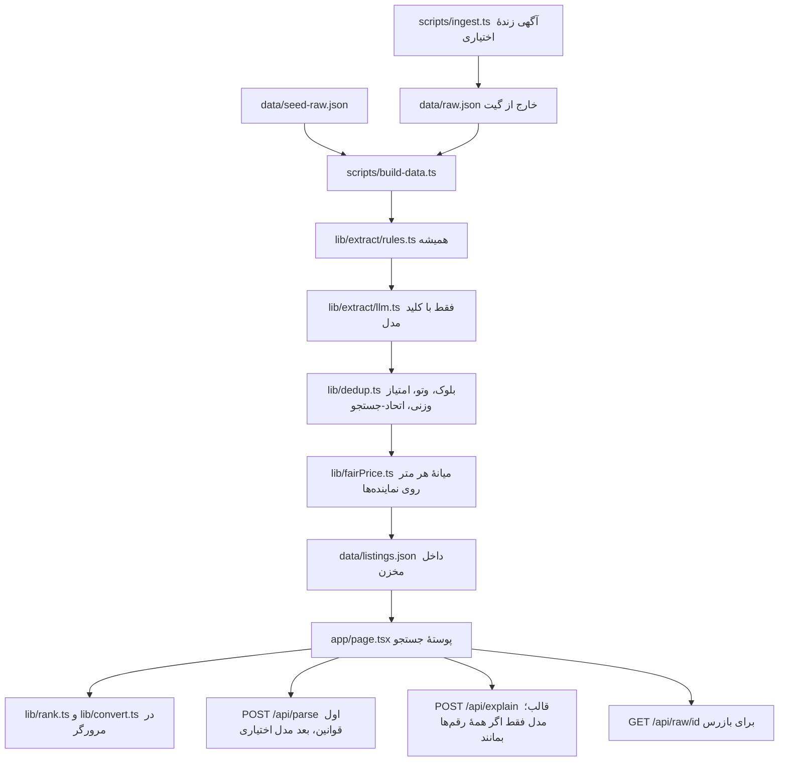

<div dir="rtl" align="right">

# ترب اجاره

<span dir="ltr">[English Documentation](./README.md)</span>

🔗 دموی زنده: https://torob-rent-project.vercel.app/

ترب اجاره موتور مقایسهٔ ترب را روی رهن و اجارهٔ تهران پیاده می‌کند: **یک ملک canonical، چند پیشنهاد آژانس.**

کاربر یک‌بار پول نقد و سقف اجاره را تنظیم می‌کند. هر ملک برای همان پول دوباره قیمت‌گذاری و رتبه‌بندی می‌شود. آگهی‌های تکراری یک کارت می‌شوند و ارزان‌ترین پیشنهاد بالا می‌آید. نشان منصفانه یا گران، هزینهٔ مؤثر ماهانه به‌ازای هر متر را با میانهٔ همان محله مقایسه می‌کند؛ میانه بعد از حذف تکرار حساب می‌شود. دو جمله‌ای که می‌گوید چرا رتبهٔ اول از دوم و سوم بهتر است فقط از همین عددها ساخته می‌شود.

رتبه‌بندی یک تابع خالص داخل مرورگر است؛ معمولاً حدود ۰٫۳ تا ۳ میلی‌ثانیه و خیلی کمتر از ۱۶ میلی‌ثانیه. مدل زبانی اختیاری است. اگر کلید نباشد، یا بازنویسی یک رقم را عوض کند، نتیجهٔ قطعی قوانین نشان داده می‌شود. دادهٔ دمو ۱۵۷ آگهی خام است: یک آگهی واقعی دیوار به‌علاوهٔ دادهٔ نمونهٔ قطعی، همراه با اسکریپت دریافت زنده. هر کارت نمونه برچسب «دادهٔ نمونه» دارد.

## صورت مسئله و منطق ترب

اجاره در تهران دو عدد است: رهن و اجارهٔ ماهانه. عرف بازار این است که هر ۱۰۰ میلیون تومان رهن اضافه، حدود ۳ میلیون تومان از اجارهٔ ماه کم می‌کند. کسی که ۲ میلیارد نقد و سقف اجارهٔ ۲۵ میلیون دارد، آگهی «۸۰۰ میلیون + ۶۰ میلیون» را در فیلتر معمولی نمی‌بیند، چون فیلتر به زوجِ نوشته‌شده نگاه می‌کند. همان آگهی بعد از تبدیل می‌شود «۲ میلیارد + ۲۴ میلیون» و در بودجه جا می‌شود. ابزار تبدیل در سایت‌های آگهی داخل همان یک آگهی است، یعنی بعد از این‌که کاربر خانه‌اش را پیدا کرده باشد.

چهار شکست از همین‌جا می‌آید:

۱. **فیلتر تبدیلِ تک‌آگهی.** امکان‌پذیری روی قیمت نوشته‌شده قضاوت می‌شود و موجودیِ قابل‌تبدیل پنهان می‌ماند.
۲. **تکرار چندآژانسی.** همان واحد را چند آژانس و گاهی خود مالک با قیمت‌های مختلف پست می‌کنند.
۳. **دام‌های فقط‌متنی.** قابلیت تبدیل، «فقط خانواده»، پارکینگ مشاع، قرارداد کوتاه یا کمیسیون اضافه اغلب فقط داخل توضیحات است.
۴. **نبود معیار قیمت محله.** دو عدد رهن و اجاره را با چشم نمی‌شود مقایسه کرد، و پست تکراری میانگین ساده را کج می‌کند.

| ایدهٔ ترب | کار این محصول |
|---|---|
| یک کالای canonical، چند پیشنهاد فروشگاه | خوشه‌بندی با اتحاد-جستجو. یک کارت، قرص «در N آگهی · صرفه‌جویی …»، و جدول ودیعه، اجاره و لینک هر آژانس |
| پرتو قیمت منصفانه | هزینهٔ مؤثر ماهانه به‌ازای متر در برابر میانهٔ نماینده‌های خوشه. سبز زیر ۸٪−، قرمز بالای ۸٪+ |
| رتبه‌بندی بر اساس قصد | یک نوار پول نقد به‌علاوهٔ جملهٔ فارسی یا فینگلیش. اول فیلتر سخت، بعد امتیاز وزنی. دو گلوله دلیل برتری اول بر دوم و سوم |
| بی‌اثر بودن جایگاه پولی | «نردبان» و «فوری» در امتیاز نیستند. اعتماد از عکس واقعی، مالک در برابر آژانس، پرچم قرمز و اطمینان استخراج می‌آید |

## معماری و پایپ‌لاین

کار آفلاین یک فایل JSON می‌سازد که در مخزن commit شده است. برنامهٔ مستقر همان فایل را می‌خواند. رتبه‌بندی منتظر شبکه یا مدل نمی‌ماند.

<div dir="ltr">



</div>

**دریافت.** <span dir="ltr">`scripts/ingest.ts`</span> جستجوی عمومی <span dir="ltr">`postlist`</span> و جزئیات <span dir="ltr">`posts-v2`</span> دیوار را برای پنج محله صدا می‌زند. بین درخواست‌ها حدود ۱٫۵ ثانیه به‌علاوهٔ کمی تصادف صبر می‌کند، روی ۴۲۹ و خطای ۵xx با تأخیر نمایی دوباره تلاش می‌کند، و نقطهٔ ادامه را در <span dir="ltr">`data/.ingest-checkpoint.json`</span> می‌نویسد. هش عکس فقط وقتی بستهٔ اختیاری <span dir="ltr">`sharp`</span> نصب باشد حساب می‌شود. اگر منبع در دسترس نباشد، برنامه روی دادهٔ نمونه می‌ماند. پست‌های شیپور و کیلید فقط داخل نمونه هستند.

**نرمال‌سازی.** <span dir="ltr">`scripts/normalize.ts`</span> همیشه <span dir="ltr">`extractListingRules`</span> را اجرا می‌کند. قوانین اول فیلد فرم را می‌خواند و بعد متن آزاد را: متراژ، خواب، طبقه، سال، امکانات، قابلیت تبدیل و پرچم قرمز. محلهٔ ناشناس رد می‌شود. اگر <span dir="ltr">`LLM_API_KEY`</span> باشد و اجرا با <span dir="ltr">`--no-llm`</span> نباشد، <span dir="ltr">`refineWithLlm`</span> می‌تواند جاهای خالی را پر کند. پرچم قرمز مدل فقط وقتی می‌ماند که شاهدش عیناً داخل متن آگهی باشد. Zod شکل JSON را چک می‌کند. هر شکست، نتیجهٔ قوانین را نگه می‌دارد. همزمانی با شش کارگر محدود است.

**تشخیص موجودیت.** <span dir="ltr">`clusterListings`</span> در <span dir="ltr">`lib/dedup.ts`</span>:

- **بلوک.** زوج‌ها فقط داخل یک محله و یک تعداد خواب مقایسه می‌شوند، و فقط وقتی اختلاف متراژ حداکثر ۵ متر باشد.
- **وتوی سخت.** طبقهٔ متفاوت، خواب متفاوت، یا اختلاف متراژ بیش از ۵ متر امتیاز صفر می‌گیرد. دو واحد شبیه در یک برج جدا می‌مانند.
- **شباهت وزنی.** متراژ ۰٫۲۰، طبقه ۰٫۱۰، سال ۰٫۱۰، تعداد طبقات ۰٫۰۵، ژاکارد امکانات ۰٫۱۰، سه‌حرفی متن با TF-IDF برابر ۰٫۲۵ (شعار آژانس حذف شده)، هم‌پوشانی dHash عکس ۰٫۲۰ (فاصلهٔ همینگ ۶ یا کمتر یعنی همان هش).
- **درِ شواهد.** بخش متن باید حداقل ۰٫۵ باشد یا هم‌پوشانی عکس حداقل ۰٫۳۴. فیلدهای ساختاری به‌تنهایی درست زیر آستانهٔ ۰٫۶۸ می‌مانند تا دو شرح ۷۰ متریِ شبیه از دو خانهٔ متفاوت ادغام نشوند.
- **اتحاد-جستجو** گروه‌های زنجیره‌ای را می‌بندد. عضو canonical کامل‌ترین رکورد است. <span dir="ltr">`priceSpread.savings`</span> اختلاف هزینهٔ ماهانهٔ بازار (۳٪) بین ارزان‌ترین و گران‌ترین آگهی است.

**تبدیل و رتبه‌بندی قطعی.** <span dir="ltr">`fitToCash`</span> و <span dir="ltr">`rankMarket`</span> با هر حرکت اسلایدر داخل مرورگر اجرا می‌شوند. در این مسیر رفت‌وبرگشت سرور نیست. روی این داده زمان اندازه‌گیری‌شده از کسری از میلی‌ثانیه تا چند میلی‌ثانیه است، زیر ۱۶ میلی‌ثانیه.

**قصد و توضیح مدل.** <span dir="ltr">`POST /api/parse`</span> بدون کلید همان برداشت قوانین را برمی‌گرداند. با کلید، جواب معتبر مدل روی برداشت قوانین ادغام می‌شود و محلهٔ غیرمجاز یا اجارهٔ منفی حذف می‌شود. <span dir="ltr">`POST /api/explain`</span> می‌تواند دو گلولهٔ از‌قبل‌محاسبه‌شده را بازنویسی کند. اگر رقمی عوض شود، قالب برمی‌گردد. مدل نه رتبه می‌دهد، نه قیمت می‌سازد، و نه ادغام را تصمیم می‌گیرد.

## تصمیم‌های مهندسی و مرز MVP

عمیق ساخته شده، چون خود محصول همین‌هاست:

- تبدیل سراسری رهن و اجاره، شامل حالتی که نرخ مالک از هزینهٔ فرصت کاربر بهتر یا بدتر است.
- ادغامِ گیت‌شده با شاهد: امتیاز زوج، دلیل وتو، کسینوس متن و هم‌پوشانی عکس برای هر عضو ذخیره و در بازرس نشان داده می‌شود.
- قیمت منصفانه روی نمایندهٔ خوشه، تا پنج کپی آژانس از یک خانهٔ ارزان میانهٔ محله را جابه‌جا نکند.
- قاعدهٔ خانوار به‌صورت فیلتر سخت («فقط خانواده» برای مجرد دیده نمی‌شود) و فهرست ردشده‌ها با دلیل.
- بازرس پایپ‌لاین: آگهی خام، فیلد نرمال و منبعش، شاهد خوشه، شکست امتیاز.

عمداً بیرون این MVP:

- کلاینت زندهٔ شیپور و کیلید. شکل‌شان در نمونه هست تا ادغام و برچسب منبع واقعی باشد؛ خزش فقط برای دیوار نوشته شده.
- حساب کاربری، جستجوی ذخیره‌شده، پیام، هشدار و پرداخت.
- سنجاق دقیق ساختمان. مختصات یک نقطهٔ پایدار داخل شعاع محله است و روی نقشه تقریبی اعلام شده.
- رابط تنظیم وزن. عبارت‌هایی مثل «مطمئن» یا «ارزان» وزن را تکان می‌دهند؛ فرمول در کد و در بازرس دیده می‌شود.
- گذاشتن مدل روی مسیر اسلایدر. تأخیر، هزینه و تکرارپذیری بدتر می‌شود و رتبه‌بندی از قبل یک تابع خالص است.

**داده، شفاف.** <span dir="ltr">`data/listings.json`</span> از <span dir="ltr">`data/seed-raw.json`</span> ساخته شده: **۱۵۷ آگهی خام** (۱۰۳ به سبک دیوار، ۲۷ شیپور، ۲۷ کیلید) در پونک، صادقیه، سعادت‌آباد، تهرانپارس و یوسف‌آباد، با سطح قیمت آبان ۱۴۰۵. یک پست (<span dir="ltr">`divar-gaxPcvmg`</span>) آگهی واقعیِ دستی است. بقیه را <span dir="ltr">`scripts/generate-seed.ts`</span> با مولد قطعی ساخته: قالب آژانس، تکراری، بند تبدیل و دام. خروجی پایپ‌لاین: **۴** نویز حذف، **۱۵۳** آگهی، **۱۱۱** ملک، **۱۹** گروه تکراری (**۴۲** پست ادغام‌شده)، **۲۵** آگهی که فقط از متن قابل‌تبدیل‌اند. هر کارت نمونه «دادهٔ نمونه» دارد. هنگام توسعه API دیوار از این دستگاه پاسخ ۵۰۲ داد، برای همین دمو روی نمونه است. <span dir="ltr">`npm run ingest`</span> برای وقتی که API جواب بدهد هنوز کلاینت کارآمد است.

## اجرا و تست

<div dir="ltr">

```bash
npm install
npm run data          # بازسازی اختیاری data/listings.json؛ با --no-llm مدل حذف می‌شود
npm test              # ۷ فایل، ۵۴ تست پاس
npm run dev           # http://localhost:3000
```

</div>

<span dir="ltr">`data/listings.json`</span> از قبل در مخزن است، پس بعد از نصب، <span dir="ltr">`npm run dev`</span> کافی است. <span dir="ltr">`npm run data`</span> استخراج قوانین، ادغام و آمار محله را دوباره اجرا می‌کند. <span dir="ltr">`npm run seed`</span> فایل <span dir="ltr">`data/seed-raw.json`</span> را از نو می‌سازد. <span dir="ltr">`npm run ingest -- --limit 20 punak`</span> یک دریافت کوتاه زنده را در <span dir="ltr">`data/raw.json`</span> می‌نویسد (خارج از گیت).

متغیرهای اختیاری <span dir="ltr">`.env`</span> در <span dir="ltr">`.env.example`</span> هستند. با کلید خالی، فهم جمله و توضیح روی مسیر قطعی می‌مانند.

<div dir="ltr">

```bash
LLM_PROVIDER=openrouter   # openai | gemini | openrouter
LLM_API_KEY=
LLM_MODEL=openai/gpt-4o-mini
CONVERSION_RATE=0.03      # نرخ بازارِ تبدیل رهن به اجاره، هنگام ساخت داده
```

</div>

تست‌ها پارس مبلغ، لبه‌های تبدیل، استخراج و پرچم قرمز، وتوی ادغام، رتبه‌بندی و سد خانوار، پارسر فارسی/فینگلیش، و حفاظ مدل را می‌پوشانند: فیلد نامعتبر حذف، پرچم بدون نقل‌قول حذف، و تغییر رقم رد می‌شود.

## فرمول رتبه‌بندی

<div dir="ltr">

```
effectiveMonthly = rent + deposit × userRate     # userRate پیش‌فرض ۰٫۰۲۵، روی ترکیب انتخاب‌شده
marketMonthly    = rent + deposit × 0.03         # محور قیمت منصفانه؛ روی خط تبدیل ۳٪ ثابت می‌ماند
fairDeltaPct     = (marketMonthly / m²) / neighborhoodMedian − 1   # به درصد

score = 0.35·cost + 0.20·fairness + 0.20·fit + 0.15·trust + 0.10·commute
cost      = 0.30·(ارزان‌تر بودن هزینهٔ مطلق بین نتایج ممکن) + 0.70·(ارزان‌تر بودن هر متر)
fairness  = 1 / (1 + exp(fairDeltaPct / 10))
```

</div>

اگر جمله وزن هزینه، اعتماد، انصاف یا تناسب را بالا ببرد، وزن‌ها دوباره روی ۱ نرمال می‌شوند. جایگاه پولی جمله‌ای در این فرمول ندارد.

</div>
